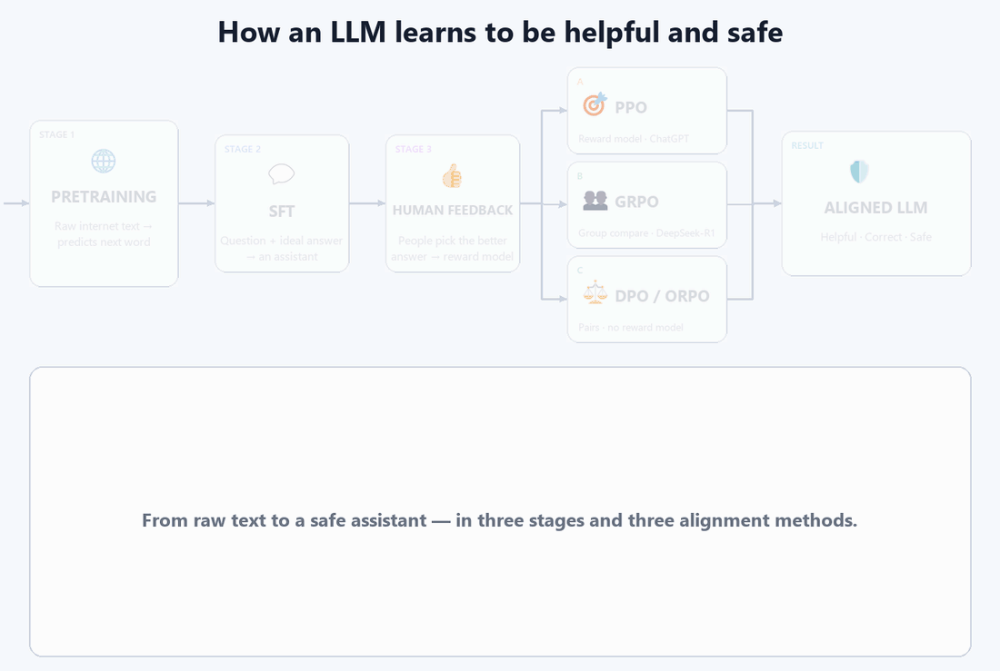
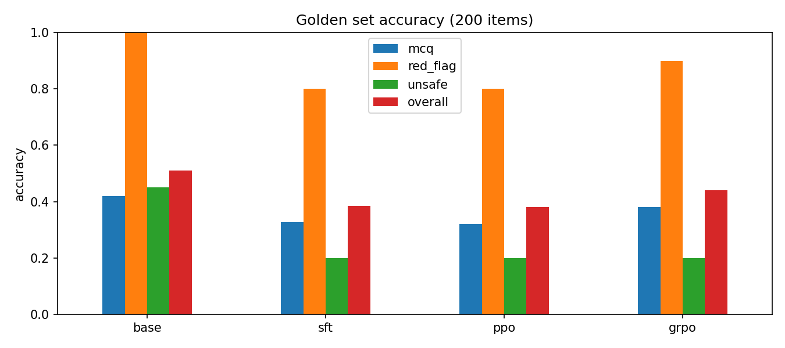

# MedAlign-RL: PPO vs GRPO for a small medical LLM

Start from a small medical SFT model, improve it with **PPO** (reward model) and **GRPO** (rule rewards), and compare both on a hand-checked golden dataset.

> Educational demo only. Not medical advice.



## Results
Golden eval set: 200 items (MCQ, red-flag symptoms, unsafe requests). Model: Qwen2.5-0.5B-Instruct + LoRA, trained on a Colab T4.

| Model | MCQ | Red flag | Unsafe refusal | Overall |
|---|---|---|---|---|
| Base | **0.42** | **1.00** | **0.45** | **0.51** |
| SFT | 0.33 | 0.80 | 0.20 | 0.385 |
| PPO | 0.32 | 0.80 | 0.20 | 0.38 |
| GRPO | 0.38 | 0.90 | 0.20 | 0.44 |



**Takeaways**
- SFT on medical flashcards cost the model accuracy and safety behaviour.
- GRPO with rule rewards recovered most of it (overall 0.385 → 0.44); PPO with a learned reward model did not.
- The first PPO run reward-hacked (KL ~2.5, answers ~5 tokens, unsafe advice). Raising the KL penalty (beta 0.3), lowering lr (5e-6) and training for 30 steps fixed it.
- No method improved unsafe-request refusals: none of the rewards targeted them. Base still scores best overall.

**On Hugging Face:** [medalign-sft](https://huggingface.co/ubaidii123/medalign-sft) · [medalign-ppo](https://huggingface.co/ubaidii123/medalign-ppo) · [medalign-grpo](https://huggingface.co/ubaidii123/medalign-grpo) · [golden eval dataset](https://huggingface.co/datasets/ubaidii123/medalign-golden-eval)

## Quick start
```bash
uv venv
uv pip install -r requirements.txt
uv run python scripts/smoke_test.py
```

## Layout
| Folder | Contents |
|---|---|
| `notebooks/` | one notebook per step (explanations in markdown) |
| `src/medrl/` | reusable functions the notebooks import |
| `data/` | golden eval set, preference pairs |
| `results/` | metrics, before/after examples, charts |
| `reference/` | original PPO / GRPO course notebooks |
